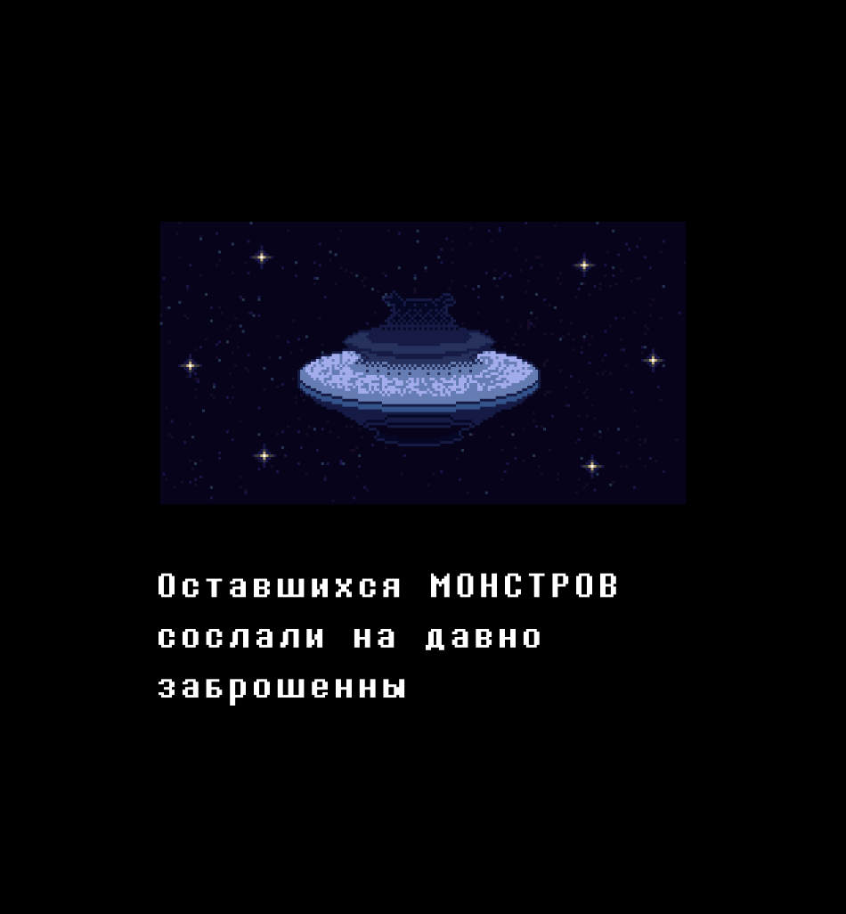
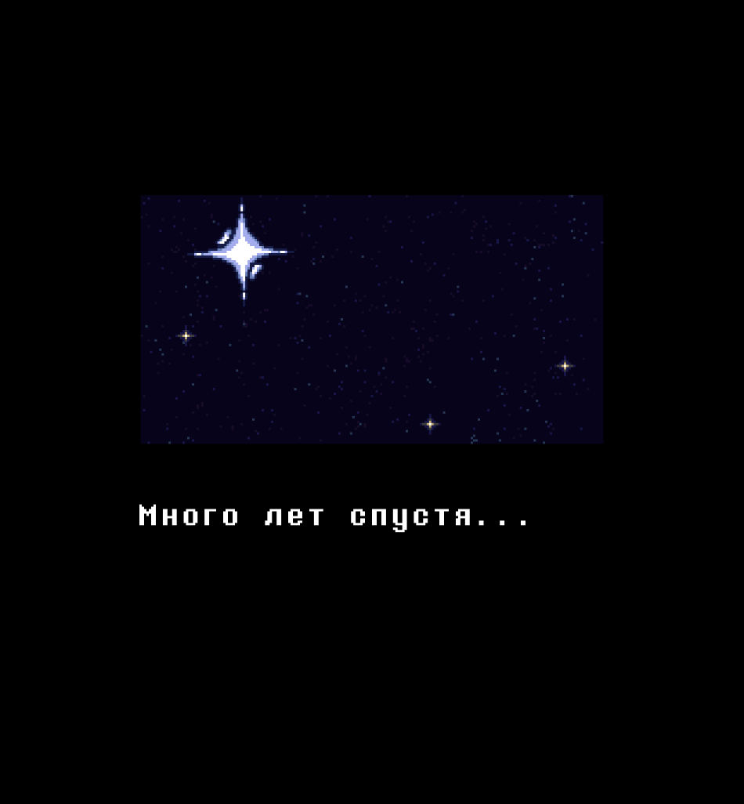

# Outertale — русская локализация

Неофициальный русский перевод для **Outertale** (Project Spacetime 5.04).



## Что это

- Мод для Outertale, добавляющий язык `ru_RU`.
- Основа — перевод сообщества с Weblate (проект `ps-outertale`): 4 041 строка.
- Ещё 22 699 строк переведены машинно (Google Translate) и постепенно правятся вручную.
- Всего в словаре 26 741 строка; 388 служебных строк (имена файлов, коды, форматы) оставлены на английском.
- Игровые теги, цвета, шрифты и переносы строк сохраняются.
- Служебные строки и имена файлов остаются на английском; английский используется как запасной язык.

> Большая часть текста переведена машинно: возможны неточные падежи, калька и неудачные формулировки. Исправления приветствуются.

## Установка

Перевод — это мод. Он не требует переустановки игры, не меняет её файлы и не трогает сохранения. Нужна только установленная **Outertale 5.04**.

Сначала установите и один раз запустите игру — при первом запуске она создаёт папку `spacetime`, куда нужно положить мод.

### Способ 1. Готовый архив (Windows, Linux, macOS)

1. Скачайте [`outertale-ru-mod.zip`](https://github.com/CutMessage/outertale-russian/releases/latest) со страницы релизов.
2. Распакуйте архив. Внутри будет папка `ru_RU`.
3. Положите папку `ru_RU` в папку `mods`:

   | Система | Куда класть `ru_RU` |
   | --- | --- |
   | Windows | `%APPDATA%\spacetime\mods\ru_RU` |
   | Linux | `~/.config/spacetime/mods/ru_RU` |
   | macOS | `~/Library/Preferences/spacetime/mods/ru_RU` |

4. Запустите игру. При первом запуске перевод включится автоматически. Если этого не произошло — откройте настройки и выберите **ЯЗЫК → ru_RU**.

Как быстро открыть нужную папку:

- **Windows:** нажмите `Win+R`, вставьте `%APPDATA%\spacetime` и нажмите Enter.
- **Linux:** в файловом менеджере нажмите `Ctrl+L` и вставьте `~/.config/spacetime/mods`.
- **macOS:** в Finder нажмите `Cmd+Shift+G` и вставьте `~/Library/Preferences/spacetime/mods`.

> Важно: внутри папки `mods` должна лежать именно папка `ru_RU`, а в ней — файл `index.js`. Если получилось `mods/ru_RU/ru_RU/index.js`, поднимите папку на один уровень выше.

### Способ 2. Установщик для Linux и macOS

Нужен `git`, `bash` и установленная Outertale 5.04.

```bash
git clone https://github.com/CutMessage/outertale-russian.git
cd outertale-russian
./install.sh
```

Установщик сам найдёт папку `mods`, сохранит предыдущую версию перевода как резервную копию и скопирует новую. После этого запустите игру.

### Способ 3. Установщик для Windows

Скачайте репозиторий (кнопка **Code → Download ZIP**), распакуйте и запустите PowerShell в папке проекта:

```powershell
.\install.ps1
```

Либо просто скопируйте папку `mods\ru_RU` в `%APPDATA%\spacetime\mods\ru_RU`.

### Способ 4. Вручную из репозитория

Скопируйте папку `mods/ru_RU` из репозитория в папку `spacetime/mods` для вашей системы (пути в таблице выше). Больше ничего настраивать не нужно.

### Как проверить, что всё работает

- В главном меню и интро текст на русском.
- В настройках появился язык `ru_RU`.
- В папке `mods/ru_RU` есть файл `index.js` размером около 4 МБ.

Если перевод не появился:

1. Убедитесь, что игра именно **5.04**.
2. Проверьте, что путь заканчивается на `spacetime/mods/ru_RU/index.js`.
3. Полностью закройте и снова запустите игру.
4. Выберите язык вручную: **Настройки → ЯЗЫК → ru_RU**.

### Обновление перевода

Скачайте новый архив и замените папку `ru_RU` целиком. `install.sh` и `install.ps1` делают резервную копию старой версии автоматически. Сохранения при обновлении не затрагиваются.

## Как это выглядит

| Интро | Второй экран |
| --- | --- |
|  |  |

## Удаление

1. Переключите язык на English в настройках игры.
2. Удалите папку `ru_RU` из `spacetime/mods`.

На Linux и macOS:

```bash
./uninstall.sh
```

Сохранения и настройки не затрагиваются.

## Совместимость

- Outertale 5.04 (Project Spacetime, внутренняя версия 5.0.3).
- Мод не меняет файлы игры и работает из пользовательской папки.
- Сохранения остаются в `~/.config/spacetime` (Linux).
- Для Arch Linux есть опциональная сборка пакета `outertale-ru` — см. [`packaging/README.md`](packaging/README.md).

## Разработка

Структура:

- `mods/ru_RU/index.js` — готовый мод (генерируется).
- `src/weblate-ru.json` — переводы Weblate.
- `src/machine-ru.json` — машинный перевод.
- `src/overrides.json` — ручные правки.
- `src/fonts.json` — пути к шрифтам.
- `tools/` — загрузка строк, перевод и сборка.

Пересобрать мод:

```bash
python3 tools/build_mod.py
```

Проверить, что `index.js` соответствует исходникам:

```bash
python3 tools/build_mod.py --check
```

Обновить машинный перевод (нужен Python 3 и интернет):

```bash
python3 tools/fetch_units.py
python3 tools/mt.py run
python3 tools/export_mt.py
python3 tools/build_mod.py
```

Ручные исправления удобнее добавлять в `src/overrides.json`: ключ — точная английская строка, значение — русский перевод.

## Авторы и права

- **Outertale** — spacey_432 и команда **Project Spacetime**. Официальный движок: <https://gitgud.io/spacey432/spacetime>.
- Оригинальный текст, спрайты, музыка, шрифты и другие ресурсы игры принадлежат spacey_432 и участникам Project Spacetime.
- **Русский перевод Weblate** — участники проекта `ps-outertale`.
- **Шрифты с кириллицей** — из русской локализации Outertale.
- **Машинный перевод** — Google Translate.
- **Мод-обёртка, установщики и инструменты** — CutMessage и участники этого репозитория.

Это неофициальный фанатский перевод. Репозиторий и релизы содержат только мод перевода и не включают файлы игры: для запуска нужна официальная Outertale 5.04. Если вы автор игры и хотите изменить условия распространения перевода — создайте issue.

## English

Fan-made Russian localization mod for Outertale 5.04. Copy `mods/ru_RU` into your `spacetime/mods` folder (or run `./install.sh` on Linux/macOS). Russian is enabled automatically on first launch; you can switch languages in Settings → LANGUAGE. Most strings are machine-translated; corrections are welcome. This repository contains no game files.

## Отказ от ответственности

Это фанатский проект, не связанный с авторами Outertale. Права на игру, оригинальные тексты, шрифты и другие ресурсы принадлежат их авторам. Репозиторий не содержит файлов игры.
